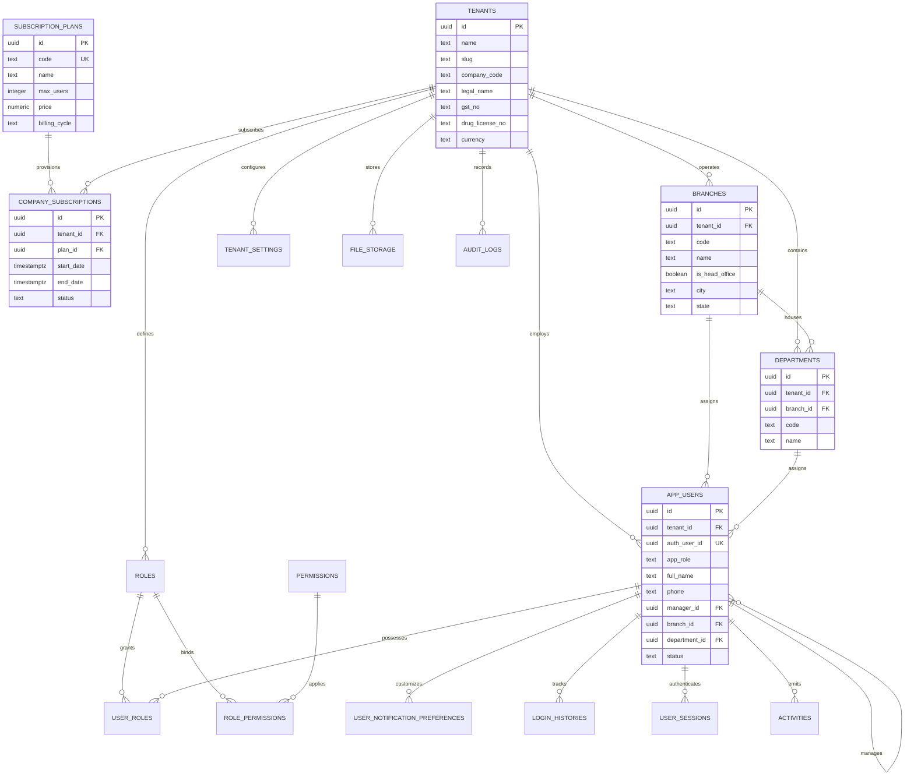
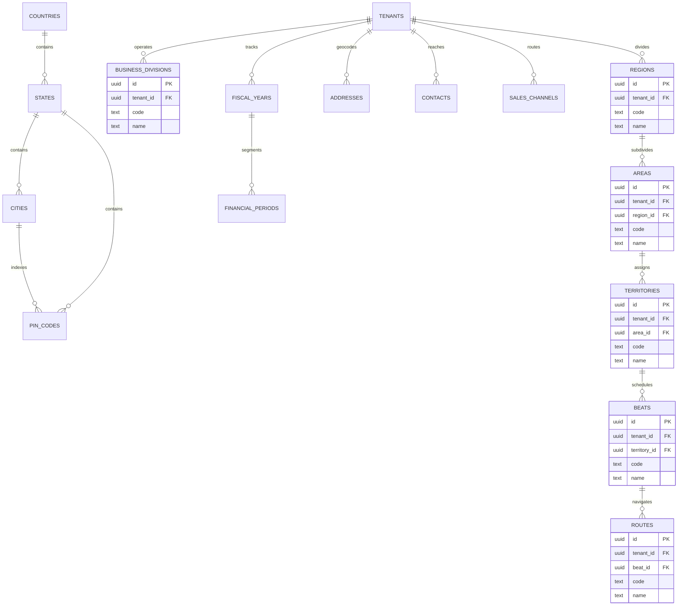
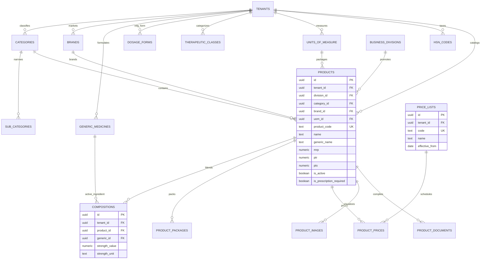
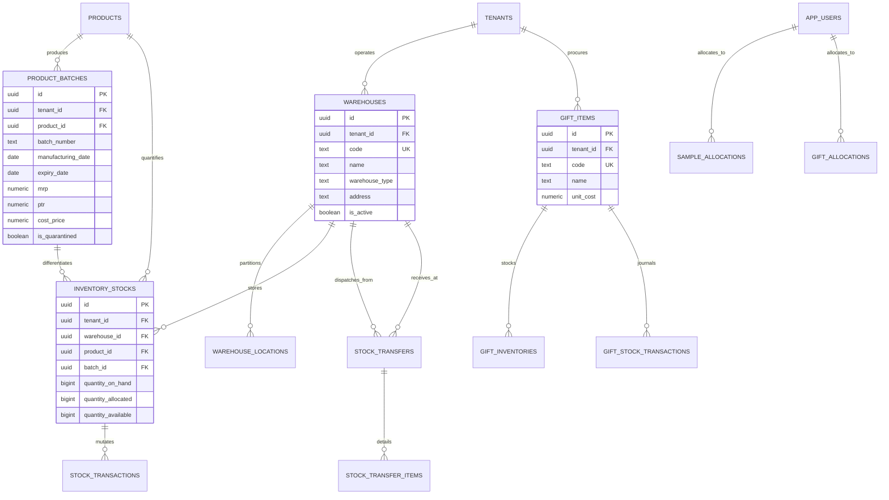
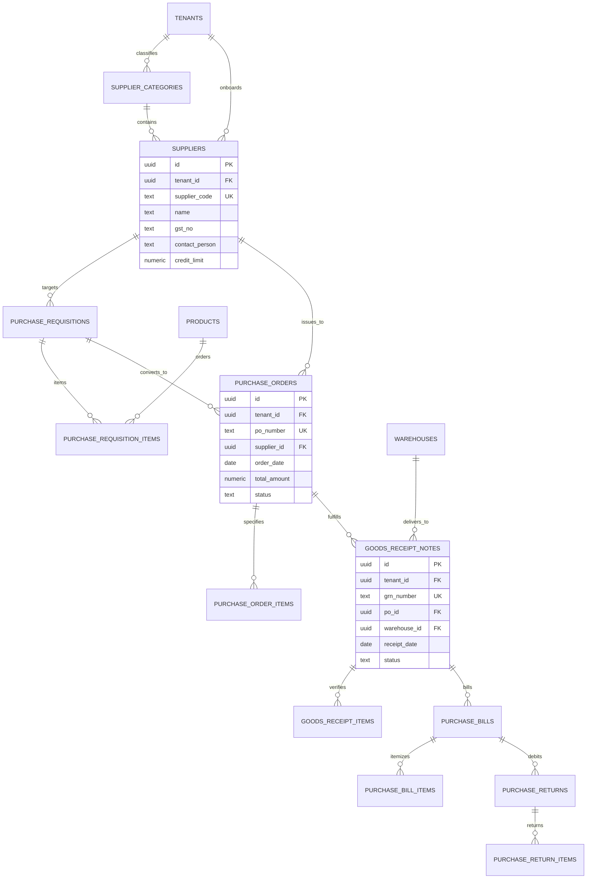
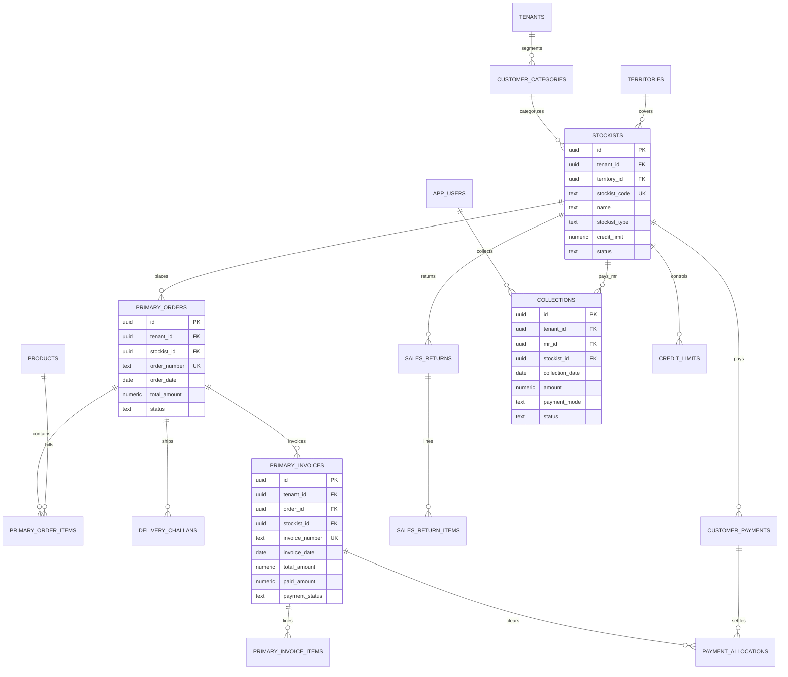
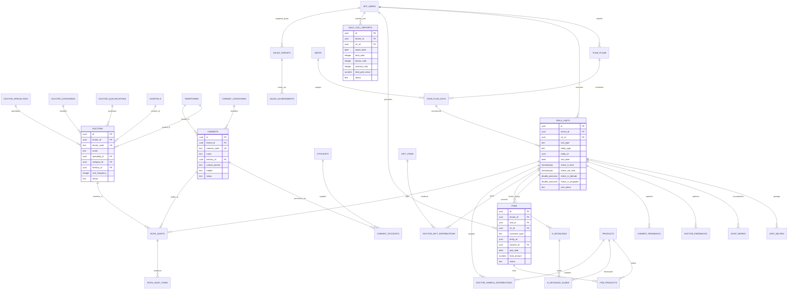
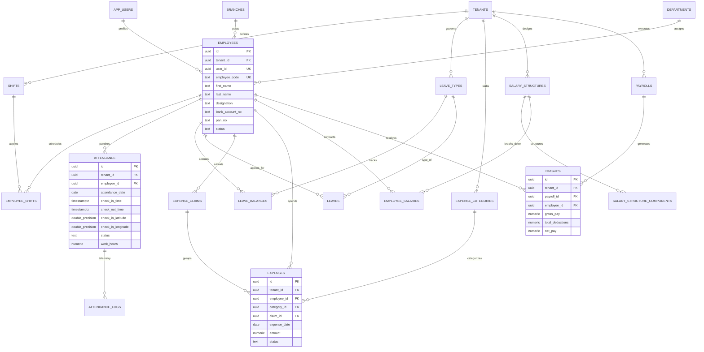
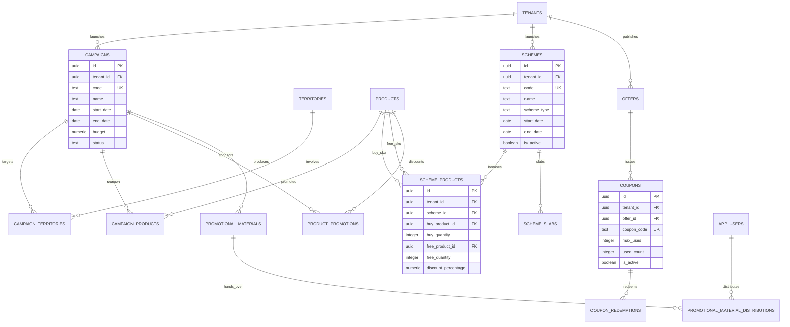

# PharmaSphere Entity-Relationship Diagrams (ERD)

This document provides comprehensive Entity-Relationship Diagrams for **PharmaSphere**, a multi-tenant pharmaceutical Sales Force Automation (SFA), Customer Relationship Management (CRM), and Enterprise Resource Planning (ERP) platform.

All tenant-scoped tables implement strict **Row-Level Security (RLS)** forced at the database engine level via `call public.apply_tenant_rls('public.<table>')` and contain mandatory audit columns (`created_at`, `updated_at`, `deleted_at`, `version`).

---

## Table of Contents
1. [Layer 1: Core Platform & Foundation](#layer-1-core-platform--foundation)
2. [Layer 2: Geography, Master Data & Sales Hierarchy](#layer-2-geography-master-data--sales-hierarchy)
3. [Layer 3: Product Catalog & Medicine Master](#layer-3-product-catalog--medicine-master)
4. [Layer 4: Warehouses, Batches & Inventory Ledger](#layer-4-warehouses-batches--inventory-ledger)
5. [Layer 5: Procurement & Suppliers (Proposed)](#layer-5-procurement--suppliers-proposed)
6. [Layer 6: Sales & Distribution (Primary Sales & Collections)](#layer-6-sales--distribution-primary-sales--collections)
7. [Layer 7: CRM & Field SFA Operations (Visits, POB, RCPA, DCR)](#layer-7-crm--field-sfa-operations-visits-pob-rcpa-dcr)
8. [Layer 8: HR, Attendance, Leave, Expense & Payroll](#layer-8-hr-attendance-leave-expense--payroll)
9. [Layer 9: Marketing, Campaigns, Schemes & Offers](#layer-9-marketing-campaigns-schemes--offers)
10. [Layer 10: Communication, Unified QR Codes, Finance & Integration](#layer-10-communication-unified-qr-codes-finance--integration)

---

## Layer 1: Core Platform & Foundation

Layer 1 establishes company multi-tenancy, user identity (`app_users` mapped to Supabase `auth.users`), role-based access control (RBAC), multi-branch organizational units, subscription tiering, and central audit/file tracking.

---

## Layer 2: Geography, Master Data & Sales Hierarchy

Layer 2 defines normalized geographical masters (Country, State, City, Pin Code) and models the hierarchical commercial sales hierarchy (Business Division $\to$ Region $\to$ Area $\to$ Territory $\to$ Beat $\to$ Route) down to polymorphic addresses and contacts.

---

## Layer 3: Product Catalog & Medicine Master

Layer 3 encapsulates pharmaceutical formulations, therapeutic classifications, generic composition ratios, packaging specifications, scheduled drug compliance, price lists (MRP, PTR, PTS), and regulatory drug licenses.

---

## Layer 4: Warehouses, Batches & Inventory Ledger

Layer 4 governs C&F depots, central warehouses, manufacturing drug batch tracking (expiry, manufacturing, quarantine), real-time stock balances, stock transaction ledgers, inter-warehouse transfers, stock adjustments, gift merchandise inventory, and MR promotional sample allocations.

---

## Layer 5: Procurement & Suppliers (Proposed)

Layer 5 manages active pharmaceutical ingredient (API) and packaging material suppliers, purchase requisitions, supplier purchase orders (PO), goods receipt notes (GRN), quality inspection, purchase bills, and vendor debit returns.

---

## Layer 6: Sales & Distribution (Primary Sales & Collections)

Layer 6 covers stockists and distributors, customer credit limits, distributor primary purchase orders, delivery challans, GST commercial tax invoices, sales returns, and field money collections.

---

## Layer 7: CRM & Field SFA Operations (Visits, POB, RCPA, DCR)

Layer 7 is the core operational field slice for Medical Representatives (MRs). It models Doctors, Retail Chemists, consulting Hospitals, Monthly Tour Plans (MTP), Geotagged Field Visits with Selfie Verification, Pre-Order Bookings (POBs), E-Detailing slide presentations, Sample/Gift handovers, Retail Chemist Prescription Audits (RCPA), Daily Call Reports (DCR), and Target Achievements.

---

## Layer 8: HR, Attendance, Leave, Expense & Payroll

Layer 8 provides employee personnel management, biometric and mobile GPS punch attendance, annual statutory leave allowances, field Daily Allowance / Travel Allowance (DA/TA) expense vouchers and claims, salary compensation structures, monthly payroll runs, and generated employee payslips.

---

## Layer 9: Marketing, Campaigns, Schemes & Offers

Layer 9 governs marketing launches, promotional product territory coverage, trade discount schemes (product bonuses such as buy 10 get 1 free), value turnover slabs, festival coupons, redemptions, and leave-behind promotional collateral.

---

## Layer 10: Communication, Unified QR Codes, Finance & Integration

Layer 10 unifies omnichannel communications (In-App Notifications, SMS, Email, WhatsApp Cloud API, Mobile Push), Polymorphic QR Codes for anti-counterfeit drug verification, Optional Finance & Accounting Ledgers, Reporting SQL Views, and Third-Party Webhook/API Key integrations.

```mermaid
erDiagram
    APP_USERS ||--o{ NOTIFICATIONS : "alerts"
    TENANTS ||--o{ EMAIL_TEMPLATES : "templates"
    TENANTS ||--o{ EMAILS : "transmits"
    TENANTS ||--o{ SMS_TEMPLATES : "DLT_templates"
    TENANTS ||--o{ SMS : "dispatches"
    TENANTS ||--o{ WHATSAPP_TEMPLATES : "meta_approved"
    WHATSAPP_TEMPLATES ||--o{ WHATSAPP : "dispatches"
    APP_USERS ||--o{ PUSH_NOTIFICATIONS : "fcm_alerts"
    TENANTS ||--o{ COMMUNICATION_LOGS : "logs"

    TENANTS ||--o{ QR_CODES : "generates"
    QR_CODES ||--o{ QR_CODE_SCANS : "telemetry"
    APP_USERS ||--o{ QR_CODE_SCANS : "scanned_by"
    QR_CODES ||--o{ QR_CODE_HISTORIES : "lifecycle"

    TENANTS ||--o{ ACCOUNT_GROUPS : "categorizes"
    ACCOUNT_GROUPS ||--o{ CHART_OF_ACCOUNTS : "organizes"
    CHART_OF_ACCOUNTS ||--o{ CHART_OF_ACCOUNTS : "parent_ledger"
    TENANTS ||--o{ BANK_ACCOUNTS : "banks_at"
    BANK_ACCOUNTS ||--o{ BANK_TRANSACTIONS : "mutates"
    BANK_ACCOUNTS ||--o{ CHEQUE_BOOKS : "issues"
    CHEQUE_BOOKS ||--o{ CHEQUE_LEAVES : "tracks"

    TENANTS ||--o{ JOURNAL_ENTRIES : "posts"
    JOURNAL_ENTRIES ||--o{ JOURNAL_ENTRY_LINES : "balances"
    CHART_OF_ACCOUNTS ||--o{ JOURNAL_ENTRY_LINES : "affects"
    JOURNAL_ENTRIES ||--o{ GENERAL_LEDGERS : "streams"

    STOCKISTS ||--o{ SECONDARY_SALES : "submits_statement"
    CHEMISTS ||--o{ SECONDARY_SALES : "sold_to"
    SECONDARY_SALES ||--o{ SECONDARY_SALES_ITEMS : "details"
    PRODUCTS ||--o{ SECONDARY_SALES_ITEMS : "units"

    TENANTS ||--o{ API_KEYS : "authenticates"
    API_KEYS ||--o{ API_REQUEST_LOGS : "monitors"
    TENANTS ||--o{ WEBHOOK_ENDPOINTS : "subscribes"
    WEBHOOK_ENDPOINTS ||--o{ WEBHOOK_DELIVERIES : "attempts"

    QR_CODES {
        uuid id PK
        uuid tenant_id FK
        text code_value UK
        text entity_type
        uuid entity_id
        text qr_type
        boolean is_active
    }

    JOURNAL_ENTRIES {
        uuid id PK
        uuid tenant_id FK
        text entry_number UK
        date entry_date
        text status
        uuid posted_by_user_id FK
    }

    SECONDARY_SALES {
        uuid id PK
        uuid tenant_id FK
        uuid stockist_id FK
        uuid chemist_id FK
        integer reporting_month
        integer reporting_year
        numeric total_value
    }

    API_KEYS {
        uuid id PK
        uuid tenant_id FK
        text key_name
        text key_prefix UK
        text hashed_key
        text_array scopes
        boolean is_revoked
    }

    WEBHOOK_ENDPOINTS {
        uuid id PK
        uuid tenant_id FK
        text target_url
        text secret
        text_array events
        boolean is_active
    }
```

---

## Reporting Views

As instructed by architecture guidelines, analytical reporting aggregates are maintained as **SQL Views** rather than redundant materialized tables:

1. **`public.view_mr_performance_summary`**  
   Aggregates total visits, doctor visits, chemist visits, stockist visits, and total Pre-Order Booking (POB) values per representative per calendar month.
2. **`public.view_doctor_coverage_metrics`**  
   Compares completed monthly doctor visits against category call frequency norms ($A^+ = 4$, $A = 2$, $B = 1$), calculating whether monthly call coverage targets were met.
3. **`public.view_secondary_sales_aggregates`**  
   Aggregates retail chemist secondary sales statements by brand SKU, reporting month, and stockist territory.
